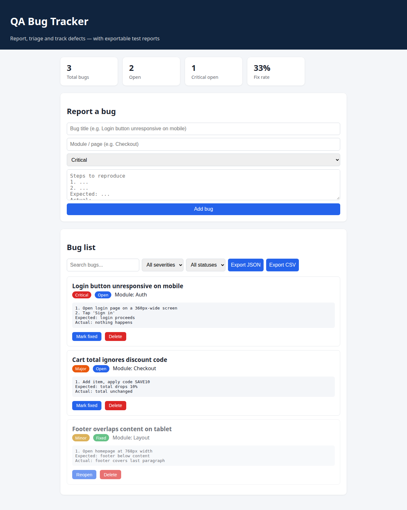
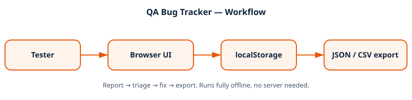

# QA Bug Tracker Dashboard


A complete bug-tracking tool for manual QA work: report defects
with severity and steps to reproduce, triage by filter and search,
track fix rate, and export the report as JSON or CSV for a client
or team. No server, no install, no framework — just open the page.

## 📸 Screenshot



## ✨ Features

- **Full bug lifecycle** — report → open → fixed → reopen, plus delete
- **Real QA fields** — severity, module, steps to reproduce,
  expected vs. actual result
- **Triage tools** — live search, severity filter, status filter
- **Live stats** — total bugs, open count, critical-open count,
  fix rate percentage
- **Exportable reports** — one-click JSON and CSV export, the
  format a QA tester actually hands to a developer or client
- **Persistent** — bugs survive refreshes via `localStorage`
- **Seeded examples** — three realistic sample bugs on first run
  so the workflow is visible immediately

## 🏗️ Architecture



```
Tester ──▶ Browser UI ──▶ localStorage ──▶ JSON / CSV export
              (single page)      (on device)     (deliverable)
```

## 📊 Severity guide

| Severity | Meaning | Example |
|---|---|---|
| Critical | Blocks core use | Login button does nothing |
| Major | Feature broken, workaround exists | Discount code ignored |
| Minor | Visual / non-blocking | Footer overlaps content |
| Trivial | Cosmetic polish | Typo in a label |

## 📁 Project structure

```
qa-bug-tracker/
├── index.html   # Page structure + report form + filters
├── style.css    # Layout, cards, severity/status tags
├── app.js       # CRUD, filters, stats, export
└── README.md
```

## 🚀 Run it

Just open `index.html` in a browser. No server, no install, no
build step. Works offline.

## 🧪 Verified behaviour

- Add, fix, reopen, and delete flow through the UI
- Filters and search narrow the list correctly
- Stats update as bugs change state
- JSON and CSV exports contain the full bug list
- JavaScript passes syntax checks

## 🗺️ Roadmap

- Attach screenshots to bug reports
- Assignee and due-date fields
- Import a previously exported JSON report

## 📄 License

MIT — see the repository root `LICENSE`.
