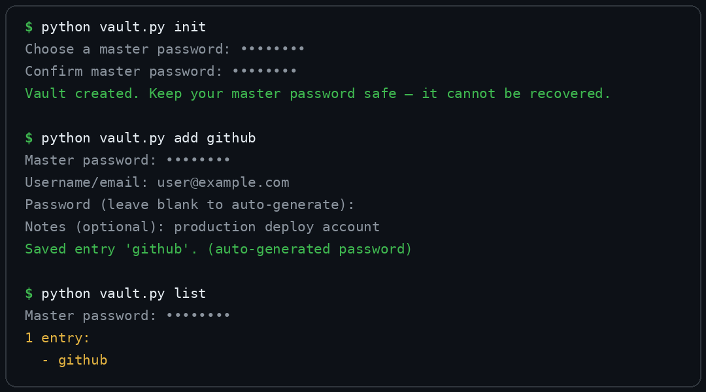
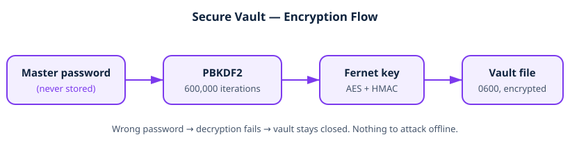

# Secure Local Vault


An encrypted credential store that runs entirely on your own
machine — no cloud account, no server, nothing leaves the device.
Secure-local-storage tooling valued in industrial and plant
environments, where sensitive data must stay offline.

## 📸 Screenshot



## ✨ Features

- **Real encryption** — Fernet (AES-128-CBC + HMAC) via the
  `cryptography` package; no home-grown ciphers
- **Strong key derivation** — PBKDF2-HMAC-SHA256, 600,000
  iterations, random 16-byte salt per vault
- **Master password never stored** — the encrypted data itself is
  the check; a wrong password simply fails decryption
- **Secure CLI habits** — passwords read with `getpass` (never in
  shell history or process arguments), auto-generated passwords
  from the `secrets` module
- **Owner-only file permissions** — vault file created with `0600`
- **Full entry lifecycle** — create, add, read, list, delete

## 🏗️ Architecture



```
Master password ──PBKDF2──▶ Key ──Fernet──▶ Encrypted vault file
     (never stored)              (~/.secure-vault.json)
```

## 🔐 Security design

| Decision | Why |
|---|---|
| PBKDF2, 600k iterations | Makes brute-force attacks expensive |
| Random salt per vault | Identical passwords produce different keys |
| Fernet (AES + HMAC) | Tampered ciphertext is detected, not decrypted |
| No stored password hash | Nothing in the file to attack offline |
| `getpass` input | Secrets never appear in shell history |
| `0600` file mode | Other users on the machine cannot read the vault |

## 📁 Project structure

```
secure-vault/
├── vault.py          # CLI: init, add, get, list, delete
├── crypto_utils.py   # Key derivation, encrypt, decrypt
├── requirements.txt
└── README.md
```

## 🚀 Installation & usage

```bash
pip install -r requirements.txt
```

```bash
python vault.py init          # create vault, set master password
python vault.py add github    # store an entry (prompts for details)
python vault.py get github    # show one entry
python vault.py list          # list entry names (never secrets)
python vault.py delete github # remove an entry
```

Leave the password blank when adding an entry and a strong
20-character password is generated for you.

## ⚠️ Honest limitations

- **Single machine, single user** — no sync, no sharing, no recovery
- **Master password is unrecoverable** — forget it and the vault
  cannot be opened, by design
- **Memory safety** — decrypted entries exist in process memory
  while the command runs, as with any local tool

## 🧪 Verified behaviour

- Create → add → read round-trip returns the exact stored entry
- Wrong master password is rejected
- Delete removes the entry; listing an empty vault reports it
- Auto-generated passwords are produced when none is supplied

## 🗺️ Roadmap

- Change master password (re-encrypt with a new key)
- Entry search and categories
- Timed clipboard copy (auto-clear after 30 seconds)

## 📄 License

MIT — see the repository root `LICENSE`.
