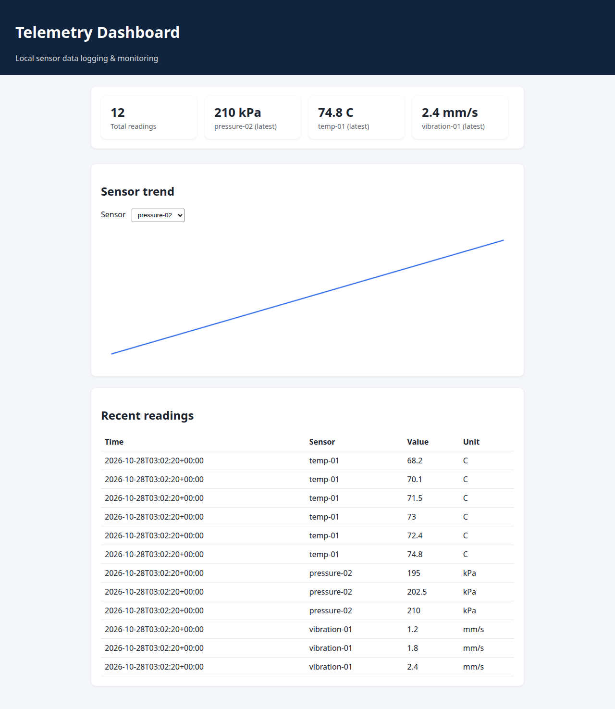
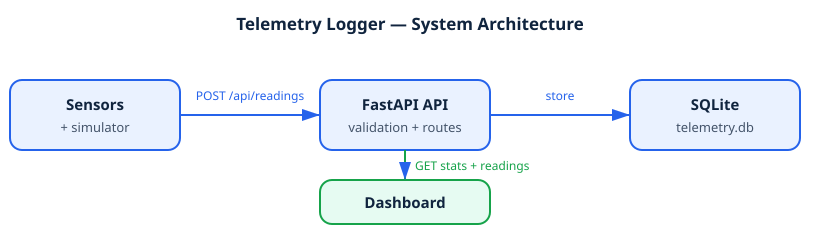

# Telemetry Logger & Dashboard


A local telemetry ingestion system for industrial environments:
devices POST sensor readings to a REST API, readings are stored in
SQLite, and a dashboard shows live stats, per-sensor trends, and
recent readings. Built as the kind of data-logging tool used in
industrial operations support.

## 📸 Screenshot



## ✨ Features

- **REST ingestion API** — POST readings with validation
  (sensor id, value, unit, timestamp)
- **Live dashboard** — served by the API itself; stats cards, a
  per-sensor trend chart, and a recent-readings table, refreshing
  every 3 seconds
- **Per-sensor history** — indexed queries power the trend chart
- **Statistics endpoint** — totals, per-sensor min / max / average,
  and latest value per sensor, aggregated in SQL
- **Sensor simulator** — generates realistic temperature, pressure,
  and vibration traffic for demos and load testing
- **Auto-generated API docs** — FastAPI's built-in Swagger UI

## 🏗️ Architecture



```
Sensors / simulator ──POST──▶ FastAPI API ──▶ SQLite (telemetry.db)
                                              │
Dashboard ◀── GET /api/stats, readings ───────┘
```

## 🛠️ Tech stack

| Layer | Technology |
|---|---|
| API | Python 3.12, FastAPI, Pydantic validation |
| Storage | SQLite (indexed on sensor + timestamp) |
| Frontend | HTML, CSS, vanilla JavaScript, Canvas chart |
| Tooling | Uvicorn server, httpx (simulator) |

## 📁 Project structure

```
telemetry-logger/
├── app/
│   ├── main.py        # API routes + dashboard hosting
│   ├── database.py    # SQLite schema + queries
│   └── models.py      # Pydantic request/response models
├── static/
│   ├── index.html     # Dashboard page
│   ├── style.css      # Dashboard styling
│   └── app.js         # Polling, stats, chart rendering
├── simulator.py       # Fake sensor traffic generator
├── requirements.txt
└── README.md
```

## 🚀 Installation & run

```bash
pip install -r requirements.txt
uvicorn app.main:app --reload
```

Open **http://127.0.0.1:8000** for the dashboard.
API docs (Swagger UI): **http://127.0.0.1:8000/docs**

### Generate demo traffic

In a second terminal:

```bash
python simulator.py
```

This simulates temperature, pressure, and vibration sensors posting
every 2 seconds. Watch the dashboard update live.

## 📡 API reference

| Method | Endpoint | Purpose |
|---|---|---|
| POST | `/api/readings` | Store one reading |
| GET | `/api/readings?limit=100` | Recent readings, newest first |
| GET | `/api/sensors/{id}/history?limit=50` | History for one sensor (chart data) |
| GET | `/api/stats` | Totals, per-sensor min/max/avg, latest values |

### Example

```bash
curl -X POST http://127.0.0.1:8000/api/readings \
  -H "Content-Type: application/json" \
  -d '{"sensor_id": "temp-01", "value": 71.5, "unit": "C"}'
# → {"id": 1, "status": "stored"}
```

Invalid input (e.g. a non-numeric value) is rejected with HTTP 422
by Pydantic validation.

## 🧪 Verified behaviour

- POST stores a reading and returns its id (201)
- GET endpoints return stored data, stats, and history correctly
- Invalid payloads are rejected (422)
- Dashboard renders stats, chart, and table from live API data

## 🗺️ Roadmap

- Alert thresholds per sensor (e.g. notify when temperature > 80°C)
- CSV export of readings
- Token authentication for ingestion endpoints
- Multi-day history charts

## 📄 License

MIT — see the repository root `LICENSE`.
